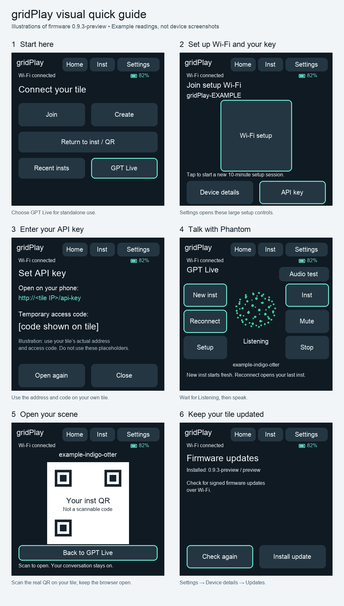

# gridPlay Tile User Manual

Use your gridPlay tile to talk with Phantom through GPT Live, create and change a CasualOS scene, and install firmware updates over Wi-Fi. The tile uses its own microphone and speaker. Standalone GPT Live does not require a Mac or a helper app; scene tools require a paired browser on your phone or computer.

This manual covers **0.9.3-preview** on the **Waveshare ESP32-S3 Touch AMOLED 2.16**. Updated October 15, 2026. The browser installer currently starts at 0.9.2-preview; install the latest update afterward to get battery status.

[Install gridPlay](https://casualware.github.io/gridPlay/) · [Firmware releases](https://github.com/casualware/gridPlay/releases) · [Repository](https://github.com/casualware/gridPlay)

## Visual quick guide

These are **illustrations of the 0.9.3-preview interface**, not device screenshots. Mint outlines highlight controls to use; example battery readings and inst names are illustrative. The QR and access-code areas contain placeholders.

[Open the full-size image](images/quick-guide.png) · [Read the short quick guide](QUICK-GUIDE.md)

## Contents

- [Visual quick guide](#visual-quick-guide)
- [Quick start](#quick-start)
- [Install on a new tile](#install-on-a-new-tile)
- [Connect to Wi-Fi](#connect-to-wi-fi)
- [Set or replace your API key](#set-or-replace-your-api-key)
- [Talk with GPT Live](#talk-with-gpt-live)
- [Open and pair your inst](#open-and-pair-your-inst)
- [Understand the controls](#understand-the-controls)
- [Battery and power](#battery-and-power)
- [Update the firmware](#update-the-firmware)
- [Troubleshooting](#troubleshooting)
- [Privacy and saved settings](#privacy-and-saved-settings)

## Quick start

If gridPlay is already installed:

1. Power the tile from its battery or USB and wait for **Wi-Fi connected**. For a new network, follow [Connect to Wi-Fi](#connect-to-wi-fi).
2. Set your OpenAI API key if you have not already done so.
3. Open **Home → GPT Live → New inst**. Wait for **Listening**, then say, “Phantom, can you hear me?”
4. Tap **Inst** and scan the QR code with your phone to open the scene. Keep that browser page open for scene tools.
5. Tap **Back to GPT Live** on the tile and try, “Create a blue cube in the middle of the scene.”
6. Tap **Stop** when you finish. Next time, use **Reconnect** to return to the last inst.

An *inst* is your shared CasualOS scene or workspace. The tile creates a name for it automatically and shows the name below the orb.

## Install on a new tile

You need the supported tile, a USB **data** cable, and a computer with desktop Chrome or Edge. You will also need a 2.4 GHz Wi-Fi network and an OpenAI API key that can access the services used by the tile.

1. Open [Install gridPlay](https://casualware.github.io/gridPlay/).
2. Connect the tile to the computer by USB. Close other apps or serial monitors using that USB connection.
3. Read the model and erase notice, then check the confirmation box.
4. Click **Install gridPlay**, select the tile’s USB serial port, and follow the installer prompts.
5. Keep the cable connected until installation finishes. Restart the tile if it does not restart automatically.
6. Set up Wi-Fi and your API key, then check for a firmware update.

**The browser installer erases the tile, including saved Wi-Fi, API keys, and settings.** Use it for first installation or deliberate recovery. For routine updates on a configured tile, use the tile’s **Updates** screen instead.

The browser can identify an ESP32-S3 chip, but cannot distinguish this Waveshare board from every other ESP32-S3 device. Confirm the exact board model before installing.

## Connect to Wi-Fi

1. On the tile, open **Settings** and tap the large **Wi-Fi setup** button. You can also use **GPT Live → Setup**.
2. Scan the setup QR with your phone, or join the tile’s temporary gridPlay Wi-Fi network manually. The network password is available in **Device details** while setup is active.
3. If your phone says the network has no internet, choose to stay connected.
4. Open **http://192.168.4.1** in your phone’s browser. Include `http://`; this local page does not use HTTPS.
5. Select your **2.4 GHz** home Wi-Fi network, enter its password, and tap **Save and connect**. Leave the CasualOS site at its existing setting unless you intend to use a different site.
6. Check the tile for **Wi-Fi connected**. You can set the API key on the same setup page.
7. Tap **Finish and close hotspot**. Return your phone to your usual Wi-Fi network.

The setup hotspot expires after ten minutes and allows one connected phone at a time. Starting a new setup session gives it a new password. The tile remembers your home Wi-Fi credentials for later use.

## Set or replace your API key

### During hotspot setup

On the page at **http://192.168.4.1**, enter your OpenAI API key and tap **Set API key**. Choose whether to enable **Remember on this tile** before saving.

### While already on home Wi-Fi

1. Connect your phone or computer to the same private Wi-Fi network as the tile.
2. Stop GPT Live, then open **Settings → API key** on the tile. You can also use **Device details → Set API key over Wi-Fi**.
3. Keep the tile’s key page open. It shows the local web address and a temporary access code.
4. Open that exact address in your browser, enter the access code and API key, choose whether to remember the key, and tap **Set API key**.
5. Return to GPT Live on the tile.

The access window closes after a successful save or removal, after ten minutes, or when you start GPT Live or leave the network. If the code expires, open a new window from the tile. Use **Remove API key** on the setup page to clear it.

| Choice | What happens |
| --- | --- |
| Leave **Remember on this tile** unchecked | The key lasts until restart. Saving a temporary key also removes any previously remembered key. |
| Check **Remember on this tile** | The key survives restart in the tile’s local storage. |

The setup pages never display a saved key. They use local HTTP, so use a trusted network. Remembered keys are stored without flash encryption; someone with physical access could recover them. Never enter your API key into an inst, a GitHub issue, or the public installer page.

## Talk with GPT Live

Open **Home → GPT Live** and choose:

- **New inst** to start a fresh workspace with an automatically generated name.
- **Reconnect** to return to the most recently saved inst, including after a restart.

Wait for **Listening** before speaking. Phantom replies through the tile’s speaker. Let the reply finish before talking again: the microphone pauses during playback, so spoken interruption is not supported.

| Orb state | Meaning |
| --- | --- |
| **Listening**, green | The tile is ready for your voice. |
| **Speaking**, pink | Phantom is replying through the speaker. |
| **Working**, purple | Phantom is thinking, planning, or changing the scene. |
| **Muted** | You have disabled the microphone. Tap **Mute** again to enable it. |
| **Stopped** | No voice session is running. Use **New inst** or **Reconnect**. |

The inst name appears below the orb. While Phantom works, an animated particle orb also appears in the inst.

Try short requests first:

- “Create a blue cube in the middle of the scene.”
- “Make that cube larger.”
- “Tell me what is in the scene.”
- “Save a version of this scene.”

For scene work, open and pair a browser as described below. Some requests may show an input card in the browser that needs your response.

**Reconnect starts a new voice conversation in the same inst.** It does not restore a recording or full transcript of the previous conversation. Scene versions and the tool manager stay in the inst. Some edit history and context depend on the browser’s local storage, so keep using the same browser when possible.

## Open and pair your inst

### With a phone

1. While GPT Live is active, tap **Inst** on the tile.
2. Scan its QR code with your phone and open the link.
3. Let the inst finish loading. The QR link carries the pairing information for the **Tile tools** panel.
4. Keep the browser open and active while asking Phantom to work on the scene.
5. On the tile, tap **Back to GPT Live** and continue talking.

Opening the inst screen or returning to GPT Live does not intentionally end the conversation. **Stop** ends it.

### With a computer camera

Open the same inst on your computer. One way is to open `https://auxplayer.com/?inst=YOUR-INST-NAME&owner=public&gridPortal=home`, replacing `YOUR-INST-NAME` with the name under the orb. This opens the scene; it does not pair the tools by itself.

In the browser’s **Tile tools** panel, choose **Scan tile QR**, allow camera access, and hold the tile’s Inst QR in view. If scanning is unavailable, use the panel’s manual pairing option or open the complete QR link on that computer. Pair the browser to the same inst shown on the tile.

Voice runs directly on the tile. Browser-based scene tools need the paired inst page to remain available. If a phone locks, closes the tab, or suspends the browser, tools may stop responding even while voice remains connected.

Insts created by this preview are **public**. Treat scene content as public, and keep the complete pairing link private because it authorizes tool pairing.

## Understand the controls

| Location | Control | Purpose |
| --- | --- | --- |
| Top bar | **Home** | Return to the main menu. Use Stop to end GPT Live explicitly. |
| Top bar | **Inst** | Open the active inst’s QR screen. |
| Top bar | **Settings** | Open Wi-Fi setup and API-key access. |
| GPT Live, left | **New inst** | Start a new workspace. |
| GPT Live, left | **Reconnect** | Start a voice session in the last inst. |
| GPT Live, left | **Setup** | Open the Wi-Fi setup hotspot. Stop your conversation before changing setup. |
| GPT Live, right | **Inst** | Show the inst QR code. |
| GPT Live, right | **Mute** | Toggle the microphone. |
| GPT Live, right | **Stop** | End the voice session. |
| GPT Live, top | **Audio test** | Run a local speaker tone and microphone check. Stop GPT Live first. |
| Settings | **Device details** | View device, battery, and network information; open Updates. Longer details can be scrolled. |

The Home screen also includes **Join**, **Create**, and **Recent insts** for the older USB companion workflow. Those controls require the companion. For standalone Wi-Fi use, enter **GPT Live** and use **New inst** or **Reconnect** instead.

## Battery and power

On **0.9.3-preview or later**, battery status appears at the right of the status bar on every screen. It refreshes approximately every three seconds.

- A percentage reports the power controller’s estimate of remaining charge.
- A charging symbol indicates charging.
- Amber means **20% or less**; red means **10% or less**, when not charging.
- **USB power** means USB is supplying power and no battery is detected.
- **Battery --** means the reading is unavailable. It does not mean zero charge.

Open **Settings → Device details** for the fuller description, including charging, USB power, or running on battery. Allow a few seconds for the display to change after plugging or unplugging USB. The percentage is an estimate, not a remaining-runtime guarantee.

You can disconnect the computer and use GPT Live over Wi-Fi as long as the tile has battery power or another USB power source. Keep reliable external power connected during firmware installation.

## Update the firmware

1. Connect the tile to Wi-Fi and reliable power.
2. Tap **GPT Live → Stop** if a session is running. Finish audio tests and close any Wi-Fi or API-key setup window.
3. Open **Settings → Device details → Updates**.
4. Tap **Check again** and review the offered version.
5. Tap **Install update**. Keep power connected while it downloads, installs, and restarts.
6. Give the tile time to complete startup, then return to **Updates** to check the installed version.

Normal Wi-Fi updates retain saved settings. A temporary API key must be entered again after the update’s restart. The tile checks signed firmware before installation; it does not install updates silently in the background.

**Preview** is the active testing channel. **Stable** has not been published, and there is currently no on-tile channel selector. The browser installer can offer an older, tested starting version; update from the tile afterward.

## Troubleshooting

| Symptom | What to try |
| --- | --- |
| The setup page at 192.168.4.1 will not load | Check that your phone is connected to the tile’s setup Wi-Fi, accept the “no internet” connection, and enter `http://192.168.4.1`. If the ten-minute window expired, start setup again. Temporarily disable a VPN if it blocks local access. |
| The API-key page on home Wi-Fi will not load | Open API key setup on the tile first and use the exact address it displays. Put both devices on the same network. Guest-network isolation can block access; use the tile’s hotspot instead. |
| The tile cannot join Wi-Fi | Check the password, signal, and that the network supports 2.4 GHz. Reopen Wi-Fi setup to select it again. |
| GPT Live reports a missing key after restart | A temporary key is cleared on restart. Enter it again or choose Remember on this tile if appropriate. |
| GPT Live stays Connecting or disconnects | Check Wi-Fi, then Stop and Reconnect. If it persists, note the exact error and firmware version. |
| Phantom does not answer | Check for Listening and that the microphone is not muted. Wait until speaker playback finishes, then try again. Stop the session and run Audio test to check local audio. |
| Voice works but scene changes fail | Open the correct inst, check its Tile tools pairing, and keep that browser active. Re-pair with the tile QR if necessary. |
| Camera scanning is unavailable | Allow browser camera access, check that another app is not using the camera, or use the manual pairing option. A phone can also scan the tile’s QR directly. |
| Battery status is missing | Check that firmware is 0.9.3-preview or later. The initial web installer currently provides 0.9.2-preview. |
| No update is offered | Check the installed version and Wi-Fi connection. You may already have the newest Preview version. |
| An update fails | Keep reliable power connected, check Wi-Fi, and retry Check again. Record the exact message if it repeats. |
| The USB installer cannot find the tile | Use a data cable, close serial-monitor apps, and reconnect. If needed, hold BOOT while pressing and releasing RESET, release BOOT, then try again. |

For a repeatable problem, [open a GitHub issue](https://github.com/casualware/gridPlay/issues) with the firmware version, exact message, and steps that caused it. Do not include API keys, Wi-Fi passwords, access codes, or complete pairing links. Browser reinstallation is a recovery option, but it erases saved settings.

## Privacy and saved settings

The tile sends voice to the configured OpenAI service during an active GPT Live conversation. Scene requests and results also involve the paired CasualOS browser. **Mute** disables microphone capture; **Stop** ends the voice session.

The tile remembers Wi-Fi credentials and the last inst. API keys are remembered only when you choose that option. Some browser history and context remain in that browser’s local storage. Public inst content is separate from the tile’s local settings: erasing the tile does not delete the inst.

Before giving a tile to someone else, remove the remembered API key and erase its saved configuration through a deliberate fresh installation. Do not share device backups or use them to provision other people’s tiles.
